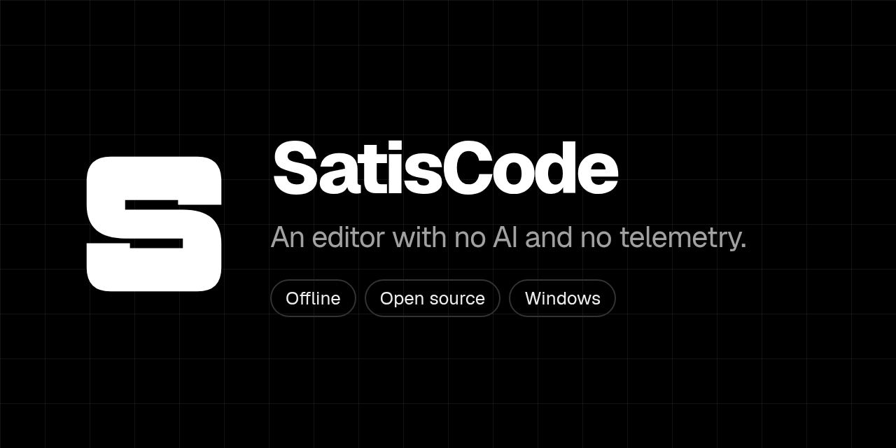
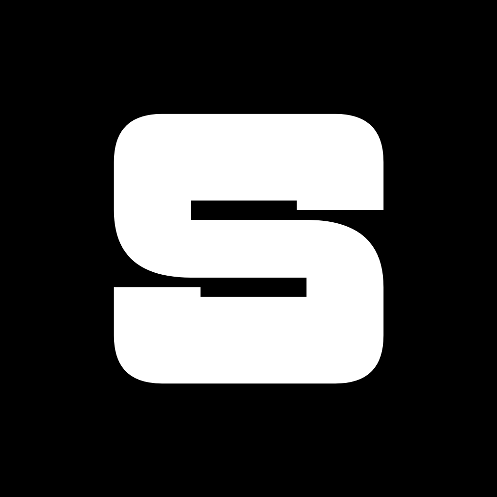
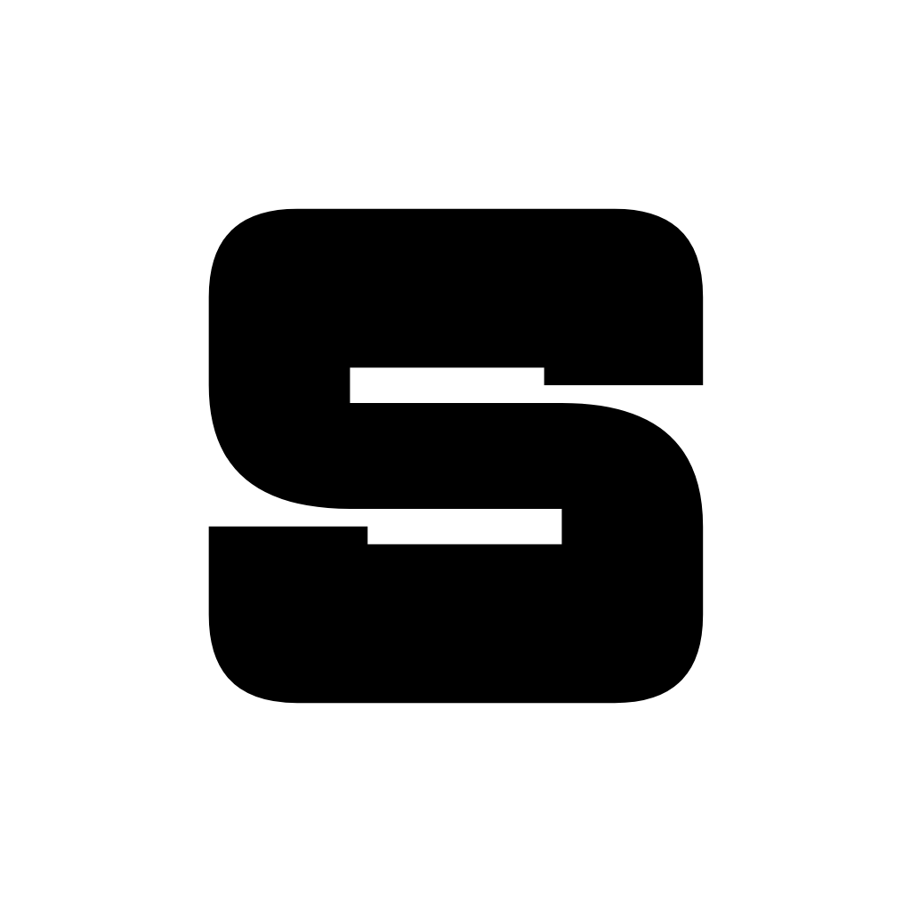
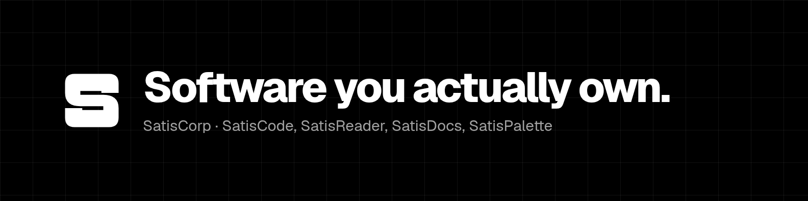

 

  

<h1 align="center">SatisCorp</h1>

  <strong>Software you actually own.</strong>

  Independent software. Built to stay yours.

  
  
  

  <a href="https://github.com/SatisCorprperation">Organization</a>
  &nbsp; · &nbsp;
  <a href="https://github.com/SatisCorprperation/Branding">Brand assets</a>

---

  

## The idea

Software should belong to the people who use it.

SatisCorp creates small, independent tools designed around privacy, simplicity and ownership. No unnecessary AI, no telemetry, no forced cloud accounts.

Your files. Your machine. Your software.

## What we believe

| Principle | Meaning |
|:--|:--|
| **No AI** | Our tools are built without integrated artificial intelligence. |
| **Offline first** | Software should work without an internet connection. |
| **Privacy** | No unnecessary tracking or telemetry. |
| **Ownership** | Your data stays under your control. |
| **Open source** | Code you can inspect, understand and contribute to. |

## Our products

<table>
  <tr>
    <td width="50%" valign="top">
      <h3>🟠 SatisCode</h3>
      An offline code editor for Windows.
        
      <a href="https://github.com/gtref/satiscode">Explore repository →</a>
    </td>
    <td width="50%" valign="top">
      <h3>🔵 SatisReader</h3>
      A modern reader for RSS and ATOM feeds.
    </td>
  </tr>
  <tr>
    <td width="50%" valign="top">
      <h3>🟢 SatisDocs</h3>
      Clean, readable web pages from Markdown files.
    </td>
    <td width="50%" valign="top">
      <h3>🟣 SatisPalette</h3>
      A search palette for any website.
    </td>
  </tr>
  <tr>
    <td width="50%" valign="top">
      <h3>⚪ SatisTimer</h3>
      A simple, focused timer.
    </td>
    <td width="50%" valign="top">
      <h3>More to come</h3>
      Small tools. No unnecessary complexity.
    </td>
  </tr>
</table>

## Our identity

  

  
  &nbsp;&nbsp;&nbsp;
  

A bold S. One shape. No unnecessary decoration.

Our visual identity follows the same principles as our software: simple, consistent and functional.

**Brand colours**

| Colour | Hex | Identity |
|:--|:--|:--|
| Black | `#000000` | Primary |
| White | `#FFFFFF` | Primary |
| Orange | `#FF8A3D` | SatisCode |
| Blue | `#52A8FF` | SatisReader |
| Green | `#50E3C2` | SatisDocs |
| Violet | `#BF7AF0` | SatisPalette |

## Brand assets

All official SatisCorp visual resources are maintained in this repository.

| Resource | File |
|:--|:--|
| Primary logo | [SVG](./logo-lockup.svg) |
| Dark logo | [SVG](./logo-lockup-dark.svg) |
| Brand mark | [SVG](./logo-mark.svg) |
| Dark brand mark | [SVG](./logo-mark-dark.svg) |
| App icon | [SVG](./logo-icon.svg) |
| PNG logo | [PNG](./logo-lockup.png) |
| GitHub avatar | [PNG](./avatar-400.png) |
| GitHub preview | [PNG](./github-social-1280x640.png) |
| X header | [PNG](./header-1500x500.png) |
| LinkedIn banner | [PNG](./linkedin-banner-1584x396.png) |
| Vertical story | [PNG](./story-1080x1920.png) |

## The brand in use

  

  

## Contributing

We welcome people who share our approach to independent software.

Explore our repositories, report issues and contribute improvements.

- Read the source code.
- Report bugs.
- Suggest features.
- Help improve documentation.

## Links

  <a href="https://github.com/SatisCorprperation">GitHub Organization</a>
  &nbsp; · &nbsp;
  <a href="https://github.com/SatisCorprperation/Branding">Brand identity</a>
  &nbsp; · &nbsp;
  <a href="https://github.com/gtref/satiscode">SatisCode</a>

---

  
    
  <strong>SatisCorp</strong>
   
  Software you actually own.
    
  © 2026 SatisCorp

