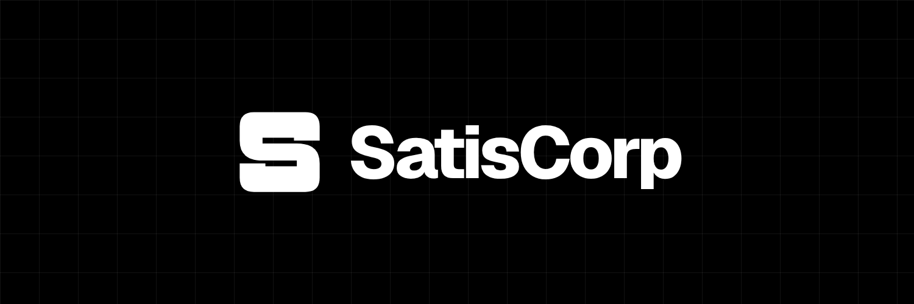

 

  

  # SatisCorp

  **Software you actually own.**

  Independent software. Built around privacy, ownership and simplicity.

  <a href="https://livepreview.usecartouche.com/satiscorp/brand">Brand Guidelines</a> · <a href="https://github.com/SatisCorprperation">GitHub Organization</a>

  
  
  

---

## Brand assets

Official SatisCorp visual identity and brand resources.

  

## Logo

| Asset | File |
|---|---|
| Primary logo | `logo-lockup.svg` |
| Dark logo | `logo-lockup-dark.svg` |
| Logo mark | `logo-mark.svg` |
| Dark logo mark | `logo-mark-dark.svg` |
| PNG logo | `logo-lockup.png` |
| App icon | `avatar-400.png` |

## Social assets

| Platform | Asset |
|---|---|
| GitHub | `github-social-1280x640.png` |
| LinkedIn | `linkedin-banner-1584x396.png` |
| Story | `story-1080x1920.png` |

## Brand principles

- **Privacy first** — No telemetry or unnecessary data collection.
- **Offline by design** — Software that works without depending on the cloud.
- **User ownership** — Your software, your data, your control.
- **Open source** — Transparent and accessible software.

## Products

| Product | Focus | Color |
|---|---|---|
| SatisCode | Code editor | `#FF8A3D` |
| SatisReader | Reading | `#52A8FF` |
| SatisDocs | Documents | `#50E3C2` |
| SatisPalette | Colors | `#BF7AF0` |
| SatisTimer | Time management | — |

## Colors

| Name | Hex |
|---|---|
| Black | `#000000` |
| White | `#EDEDED` |
| SatisCode | `#FF8A3D` |
| SatisReader | `#52A8FF` |
| SatisDocs | `#50E3C2` |
| SatisPalette | `#BF7AF0` |

## Guidelines

For logo usage, typography, colors, spacing, product identity and brand rules, consult the official guide:

**[SatisCorp Brand Guidelines →](https://livepreview.usecartouche.com/satiscorp/brand)**

---

  **SatisCorp**

  Software you actually own.

  <a href="https://livepreview.usecartouche.com/satiscorp/brand">Official Brand Guidelines</a>

