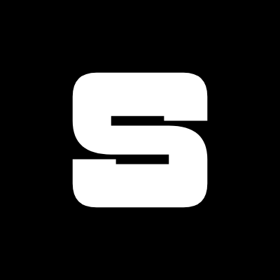
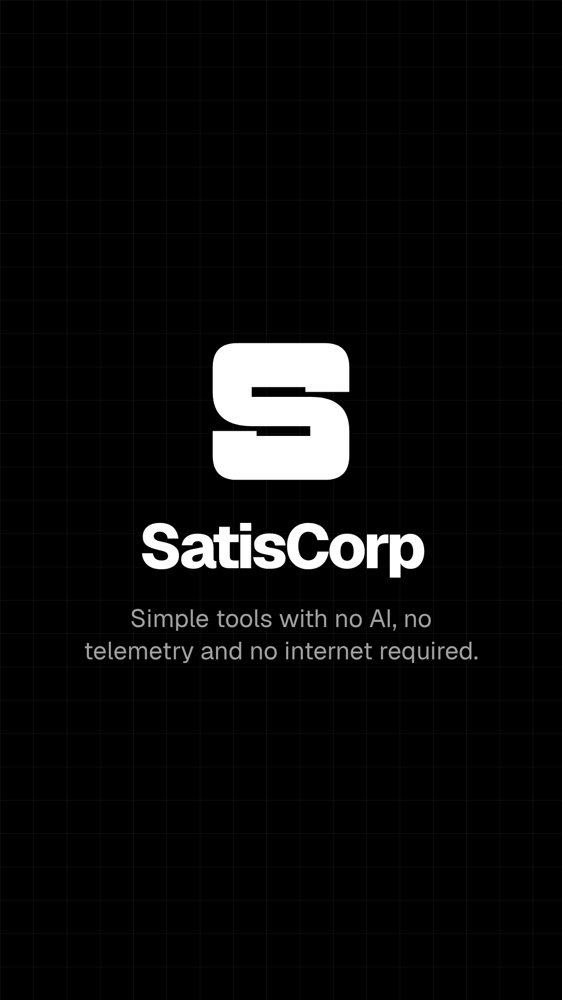

# SatisCorp — Brand Identity & Design System

<p align="center">
  
</p>

<p align="center">
  **Software you actually own.**
  <br>
  Simple tools. No AI. No telemetry. No cloud dependency.
</p>

<p align="center">
  <a href="https://github.com/gtref/satiscode"></a>
  <a href="https://github.com/gtref/satiscode"></a>
  <a href="https://github.com/gtref/satiscode"></a>
  <a href="https://github.com/gtref/satiscode"></a>
</p>

---

## About this repository

This repository contains the official visual identity and brand resources of **SatisCorp**.

It is the central source for SatisCorp logos, icons, social media graphics, product branding, design tokens, colours, typography and visual guidelines.

These assets are intended for use across SatisCorp products, websites, documentation, applications, social media and other official communications.

**One identity. One consistent design language.**

---

## Table of contents

- [Brand principles](#brand-principles)
- [Logo collection](#logo-collection)
- [Logo construction](#logo-construction)
- [Logo variations](#logo-variations)
- [Social media assets](#social-media-assets)
- [Product identities](#product-identities)
- [Colour palette](#colour-palette)
- [Design tokens](#design-tokens)
- [Typography](#typography)
- [Shape and spacing](#shape-and-spacing)
- [Badges](#badges)
- [Accessibility](#accessibility)
- [Usage guidelines](#usage-guidelines)
- [Repository structure](#repository-structure)
- [History](#history)

---

# Brand principles

Five ideas guide everything we build.

SatisCorp started from one frustration: artificial intelligence creeping into everything. Our answer is to build software that stays simple, stays offline and belongs to the people who use it.

### Small

Tools you can understand. Few features, done well, easy to read and easy to run.

### Offline

Everything works without an internet connection. Nothing needs a server to start.

### Yours

Your files, your machine, your settings. No account, no lock-in.

### Plain

Clear words and calm design. We explain what a tool does and what it does not do.

### Open

Open source and free, so anyone can read the code and check what we say.

---

# Logo collection

The SatisCorp identity is built around a bold, simple S mark.

It is designed to be recognisable at small sizes, work on different backgrounds and remain consistent across all platforms.

## Primary logo

<p align="center">
  
</p>

**Horizontal lockup — SVG**

[Download logo-lockup.svg](./logo-lockup.svg)

## Dark logo

<p align="center">
  
</p>

**Dark variation — SVG**

[Download logo-lockup-dark.svg](./logo-lockup-dark.svg)

## Standalone mark

<p align="center">
  
</p>

**White mark — SVG**

[Download logo-mark.svg](./logo-mark.svg)

## Dark standalone mark

<p align="center">
  
</p>

**Black mark — SVG**

[Download logo-mark-dark.svg](./logo-mark-dark.svg)

## App icon

<p align="center">
  
</p>

**App icon — SVG**

[Download logo-icon.svg](./logo-icon.svg)

## PNG versions

| Asset | Preview / Download |
|---|---|
| Logo mark, white on black, 1024 px | [logo-mark-1024.png](./logo-mark-1024.png) |
| Logo mark, black on white, 1024 px | [logo-mark-dark-1024.png](./logo-mark-dark-1024.png) |
| Complete logo | [logo-lockup.png](./logo-lockup.png) |

---

# Logo construction

The SatisCorp mark is built on a simple 64 × 64 grid.

The geometry is deliberately minimal, with consistent proportions and rounded corners.

### Construction principles

- Square proportions.
- 56 × 56 units of visible mark.
- 4 units of internal margin.
- One solid colour.
- No gradients or outlines.
- Consistent geometry.
- Readable down to 16 pixels.

The mark should never be stretched, rotated, distorted or reconstructed using a different typeface.

---

# Logo variations

The logo is designed to work in both dark and light environments.

| Version | Recommended background |
|---|---|
| White mark | Black |
| Black mark | White |
| White lockup | Black or charcoal |
| Black lockup | White or light grey |
| Product mark | Product accent colour |

On coloured backgrounds, use whichever version provides the strongest contrast.

Never place the mark over a visually busy photograph.

---

# Social media assets

Official SatisCorp graphics for social platforms and online profiles.

## GitHub profile picture

<p align="center">
  
</p>

**400 × 400 px**

[Download avatar-400.png](./avatar-400.png)

## GitHub social preview

<p align="center">
  
</p>

**1280 × 640 px**

[Download github-social-1280x640.png](./github-social-1280x640.png)

## X / Twitter header

<p align="center">
  
</p>

**1500 × 500 px**

[Download header-1500x500.png](./header-1500x500.png)

## LinkedIn banner

<p align="center">
  
</p>

**1584 × 396 px**

[Download linkedin-banner-1584x396.png](./linkedin-banner-1584x396.png)

## Vertical story

<p align="center">
  
</p>

**1080 × 1920 px**

[Download story-1080x1920.png](./story-1080x1920.png)

---

# Product identities

Each SatisCorp product shares the same visual foundation while having its own accent colour.

The accent should appear as a thin line, a dot or a highlight, never as an unnecessary full-page background.

| Product | Description | Accent |
|---|---|---|
| **SatisCode** | An offline code editor for Windows. | `#FF8A3D` |
| **SatisReader** | A lightweight RSS and ATOM feed reader. | `#52A8FF` |
| **SatisDocs** | Markdown files presented as clean web pages. | `#50E3C2` |
| **SatisPalette** | A search palette for any website. | `#BF7AF0` |
| **SatisTimer** | A simple, focused timer. | Shared brand palette |

### SatisCode

Orange — `#FF8A3D`

### SatisReader

Blue — `#52A8FF`

### SatisDocs

Green — `#50E3C2`

### SatisPalette

Violet — `#BF7AF0`

All products should remain recognisable as part of the SatisCorp family.

---

# Colour palette

The SatisCorp identity is primarily black and white.

Colour is used sparingly to communicate meaning, distinguish products and highlight important interface elements.

## Dark theme

| Name | Hexadecimal | Usage |
|---|---|---|
| Black | `#000000` | Main background |
| Surface 0 | `#050505` | Cards |
| Surface 1 | `#0A0A0A` | Panels |
| Surface 2 | `#111111` | Inputs and chips |
| Soft White | `#EDEDED` | Main text |
| Grey | `#A1A1A1` | Secondary text |
| Dim | `#8A8A8A` | Labels |
| White | `#FFFFFF` | Strong text |

## Light theme

| Name | Hexadecimal | Usage |
|---|---|---|
| Paper | `#FAFAFA` | Main background |
| Surface | `#F4F4F5` | Cards |
| Surface 2 | `#EFEFF1` | Panels |
| Surface 3 | `#E6E6E9` | Inputs and chips |
| Ink | `#171717` | Main text |
| Muted | `#4F4F55` | Secondary text |
| Dim | `#707078` | Labels |
| Black | `#000000` | Strong text |

## Product and status accents

| Name | Hexadecimal |
|---|---|
| SatisCode Orange | `#FF8A3D` |
| SatisReader Blue | `#52A8FF` |
| SatisDocs Green | `#50E3C2` |
| SatisPalette Violet | `#BF7AF0` |
| Error Red | `#FF6166` |
| Warning Amber | `#F5A623` |

---

# Design tokens

The following CSS variables represent the core SatisCorp colour system.

```css
/* SatisCorp design tokens: dark theme */

:root {
  --bg: #000000;
  --s0: #050505;
  --s1: #0A0A0A;
  --s2: #111111;

  --ink: #EDEDED;
  --muted: #A1A1A1;
  --dim: #8A8A8A;

  --line: rgba(255, 255, 255, 0.10);
  --line2: rgba(255, 255, 255, 0.20);

  --ok: #50E3C2;

  --satiscode: #FF8A3D;
  --satisreader: #52A8FF;
  --satisdocs: #50E3C2;
  --satispalette: #BF7AF0;

  --font: 'Geist', system-ui, sans-serif;
  --mono: 'Geist Mono', ui-monospace, monospace;
}

/* Light theme */

html[data-theme="light"] {
  --bg: #FAFAFA;
  --s0: #F4F4F5;
  --s1: #EFEFF1;
  --s2: #E6E6E9;

  --ink: #171717;
  --muted: #4F4F55;
  --dim: #707078;

  --line: rgba(0, 0, 0, 0.12);
  --line2: rgba(0, 0, 0, 0.24);

  --ok: #067A62;
}
```

---

# Shape and spacing

SatisCorp uses rounded corners, subtle borders and consistent spacing.

## Corner radius

| Value | Usage |
|---|---|
| 8 px | Chips and small buttons |
| 12 px | Inputs and list rows |
| 16 px | Cards |
| 20 px | Large cards and panels |
| 99 px | Pills and rounded buttons |

## Spacing scale

The spacing system uses multiples of four:

`4 · 8 · 12 · 16 · 24 · 32 · 48 · 72`

## Borders

- Standard border: 10% opacity.
- Strong border: 20% opacity.
- Prefer subtle borders over heavy shadows.

---

# Typography

SatisCorp uses two typefaces.

## Geist

The primary typeface for headings, body text and interfaces.

Recommended weights:

- Light
- Regular
- Semibold
- Extra Bold

## Geist Mono

Used for code, technical information, labels and numerical values.

Recommended weights:

- Regular
- Semibold

Both typefaces are available under the SIL Open Font License.

Typography should be clear, compact and easy to read.

---

# Icons

SatisCorp icons follow a minimal outline-based design language.

### Icon principles

- 24 × 24 px grid.
- 1.8 px stroke.
- Rounded line caps.
- Rounded line joins.
- No unnecessary decoration.
- No solid fills unless required.

Icons should inherit the surrounding text colour and remain consistent in both light and dark themes.

---

# Badges

SatisCorp provides four official badges for use in repositories, documentation and websites.

These badges communicate important software principles.

## No AI

<a href="https://github.com/gtref/satiscode">
  
</a>

## Works offline

<a href="https://github.com/gtref/satiscode">
  
</a>

## No telemetry

<a href="https://github.com/gtref/satiscode">
  
</a>

## Edited with SatisCode

<a href="https://github.com/gtref/satiscode">
  
</a>

### HTML implementation

Copy the following code into your README:

```html
<a href="https://github.com/gtref/satiscode">
  
</a>

<a href="https://github.com/gtref/satiscode">
  
</a>

<a href="https://github.com/gtref/satiscode">
  
</a>

<a href="https://github.com/gtref/satiscode">
  
</a>
```

---

# Accessibility

Accessibility is part of the design, not an optional addition.

### Contrast

The colour system is designed to meet WCAG contrast requirements.

| Combination | Contrast ratio | WCAG |
|---|---:|---|
| Soft White on Black | 17.9:1 | AAA |
| Grey on Black | 8.1:1 | AAA |
| Dim on Black | 6.1:1 | AA |
| White on Black | 21.0:1 | AAA |
| Ink on Paper | 17.2:1 | AAA |
| Muted on Paper | 7.8:1 | AAA |
| Dim on Paper | 4.7:1 | AA |

### General rules

- Every interactive control must be keyboard accessible.
- Focus indicators must remain visible.
- Colour must never be the only way to communicate status.
- Respect reduced-motion preferences.
- Avoid automatically playing sounds or animations.
- Keep text readable and appropriately sized.

---

# Imagery

Real software, real interfaces, no generic stock photography.

The best representation of a product is the product itself.

### Guidelines

- Show real application screenshots.
- Preserve the actual application interface.
- Use rounded frames and subtle borders.
- Use the product accent as a small visual highlight.
- Avoid unnecessary stock images.
- Do not use photographs of people without their agreement.

---

# Voice and communication

SatisCorp communicates in a plain, calm and honest way.

### We write

- Short sentences.
- Everyday words.
- Clear explanations.
- Verifiable statements.
- Honest descriptions of functionality.

### We avoid

- Unnecessary marketing hype.
- Unsupported claims.
- Artificial urgency.
- Excessive exclamation marks.
- Fear-based messaging about AI.

**Example**

Good:

> SatisCode is an editor that works offline. It has no AI and no telemetry.

Avoid:

> Unleash the power of our revolutionary, seamless coding experience!

---

# Usage guidelines

The SatisCorp brand should remain consistent wherever it appears.

### Do

- Use official logo files.
- Maintain original proportions.
- Preserve clear space around the mark.
- Use approved brand colours.
- Choose the correct logo for the background.
- Keep the design simple.

### Do not

- Stretch or rotate the logo.
- Change its proportions.
- Add unnecessary shadows.
- Apply gradients to the mark.
- Use unapproved colours.
- Place it over busy photographs.
- Recreate the logo using ordinary text.

### Clear space

Keep a margin around the mark equal to half its width.

Nothing should enter this protected area.

---

# Repository structure

The official branding repository contains the following resources:

```text
Branding/
│
├── README.md
│
├── avatar-400.png
├── github-social-1280x640.png
├── header-1500x500.png
├── linkedin-banner-1584x396.png
├── story-1080x1920.png
│
├── logo-icon.svg
├── logo-lockup-dark.svg
├── logo-lockup.svg
├── logo-lockup.png
├── logo-mark-1024.png
├── logo-mark-dark-1024.png
├── logo-mark-dark.svg
└── logo-mark.svg
```

This repository is the reference point for the official SatisCorp visual identity.

---

# History

## November 2026 — Brand identity version 2

SatisCorp introduced a new visual identity based on a bold, squared S.

The previous mark, an S inside a circle, was replaced by a simpler standalone symbol built on a consistent grid.

The updated identity focuses on:

- Better readability at small sizes.
- A more recognisable silhouette.
- A simpler black-and-white visual language.
- Consistent branding across all products.
- A unified design system.

## November 2026 — Official brand repository

The official brand assets, logos, icons, social graphics and design guidelines were collected in this repository.

---

<p align="center">
  
</p>

<p align="center">
  **SatisCorp**
  <br>
  Software you actually own.
  <br><br>
  <a href="https://github.com/SatisCorprperation">GitHub Organization</a>
  ·
  <a href="https://github.com/SatisCorprperation/Branding">Brand Repository</a>
</p>

<p align="center">
  © 2026 SatisCorp.
  <br>
  Brand identity and official visual resources.
</p>
